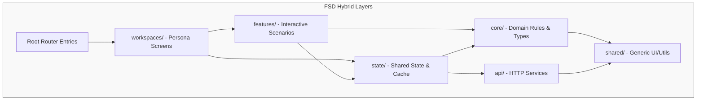

# Architectural Guide: Refactored Upcoming Inbound Module

This guide outlines the purpose, file mapping, and import/dependency rules for the new hybrid **Feature-Sliced Design (FSD)** structure of the `upcoming-inbound` module.

---

## 1. Directory Overview & Dependency Flow



* **Core Rule:** Imports must always flow **downward**. A layer should never import code from a layer above it (e.g., `core/` must never import from `features/` or `state/`).

---

## 2. Folder-by-Folder Guide

### 📂 `core/` (Domain Logic & Translators)
* **Purpose**: Houses pure business rules, permissions, types, and translations. It is decoupled from React UI components.
* **Key Files**:
  * `workflow.ts`: Contains state machine transitions, status color mappings, and phase logic.
  * `permissions.ts`: Domain permission rules (e.g., `canApprove`, `canSkipQC`).
  * `mappers.ts`: Maps backend API DTOs into frontend-friendly model types.
  * `types.ts` & `constants.ts`: Shared domain interfaces, Enums, and configuration values.
* **Usage**:
  ```typescript
  // Example: Inside a UI component
  import { getReceiptDisplayStatus } from '../core/workflow';
  ```

### 📂 `api/` (Network Communication)
* **Purpose**: The direct layer communicating with backend endpoints. No business calculations or UI logic lives here.
* **Key Files**:
  * `service.ts`: API request calls (using Axios or request clients).
  * `dto.ts`: Declares request and response contract interfaces exactly as received from the server.
* **Usage**: Holds raw fetches. `state/` hooks will invoke these methods.

### 📂 `state/` (Data Orchestration & Caching)
* **Purpose**: Manages runtime React context, query caching (React Query), and state hooks shared across features.
* **Key Files**:
  * `InboundProvider.tsx`: Context wrapper managing active filters, selected tabs, or user roles.
  * `useGoodsReceipts.ts` / `usePurchaseOrders.ts`: Hooks wrapping API calls to handle caching, loading indicators, and mutations.
  * `useInboundWorkspace.ts`: Manages active screen configurations.
* **Usage**: Shared states between panels and tables are read from here.

### 📂 `features/` (Interactive Scenarios)
* **Purpose**: Encapsulates specific interactive features or user operations.
* **Subfolders**:
  * `goods-receipt/`: Managing GR creation, editing, and linking.
  * `purchase-order/`: Details and operations relating to PO sidebars/tables.
  * `qc-review/`: Action forms for QC inspections.
  * `supervisor-review/`: Approvals, rejections, and correction prompts.
  * `procurement/`: Exception resolution actions (`CloseRefundModal`, `ReissuePOModal`, `ReleaseWarehouseModal`).
  * `supporting-documents/`: Upload lists, previews, and attachments.
* **Internal Structure of a Feature**:
  ```text
  features/my-feature/
  ├── components/          # Feature-specific modals, forms, and cards
  ├── hooks/               # Local UI controllers (e.g., useModalState)
  ├── utils/               # Internal helpers specific to this feature
  └── index.ts             # Public exports (Exposes only what workspaces need)
  ```
* **Strict Rule**: **No Cross-Feature Imports**. For example, `qc-review/` should never import from `supervisor-review/`. If they need to share UI or logic, move it to `shared/` or `core/`.

### 📂 `workspaces/` (Persona-Based Dashboards)
* **Purpose**: Compose features and entities into full workspaces depending on who is logged in.
* **Key Files**:
  * `WarehouseWorkspace.tsx`: Screens customized for warehouse operators (lists, GR templates).
  * `QCWorkspace.tsx`: Displays QC queues and inspection actions.
  * `SupervisorWorkspace.tsx`: Multi-approval views, history, and status checks.
  * `ProcurementWorkspace.tsx` (formerly `inboundprocurementlist.tsx`): Exceptions resolutions panel.
* **Usage**: Workspaces read status from `state/`, pass props to `features/` components, and coordinate layout actions.

### 📂 `shared/` (Generic Library)
* **Purpose**: Infrastructure pieces that can be reused anywhere in the app (completely generic).
* **Key Files**:
  * `ui/`: Custom generic wrappers, custom spinners, and visual buttons.
  * `hooks/`: E.g., `useDebounce`, `useWindowDimensions`.
  * `utils/`: Date formatters, currency math helpers.

---

## 3. Entry Points (Page Coordinates)

At the root of the `upcoming-inbound/` directory:

1. **`index.tsx`**: Route entry-point mapping to `/prod/inventory-inbound/*`. It bootstraps standard operations.
2. **`procurement.tsx`**: Route entry-point mapping to `/prod/inventory-inbound/procurement/*`. It loads the procurement dashboard.
3. **`InboundListview.tsx`**: The parent coordinator that initializes `<InboundProvider>` and swaps the appropriate workspace based on role and URL path parameters.
